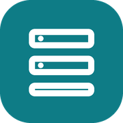
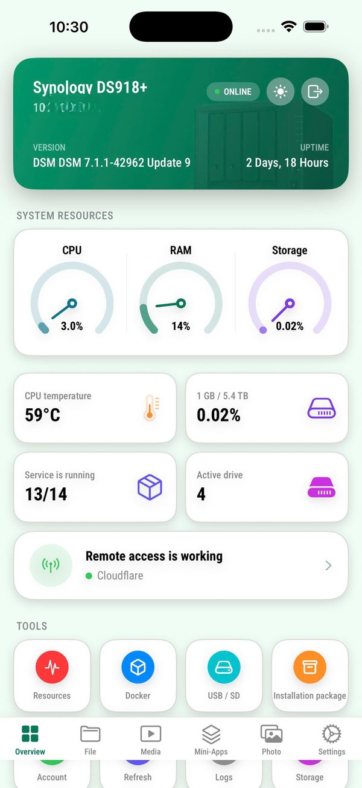
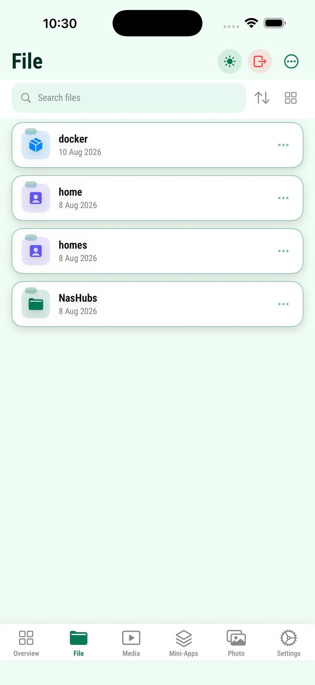
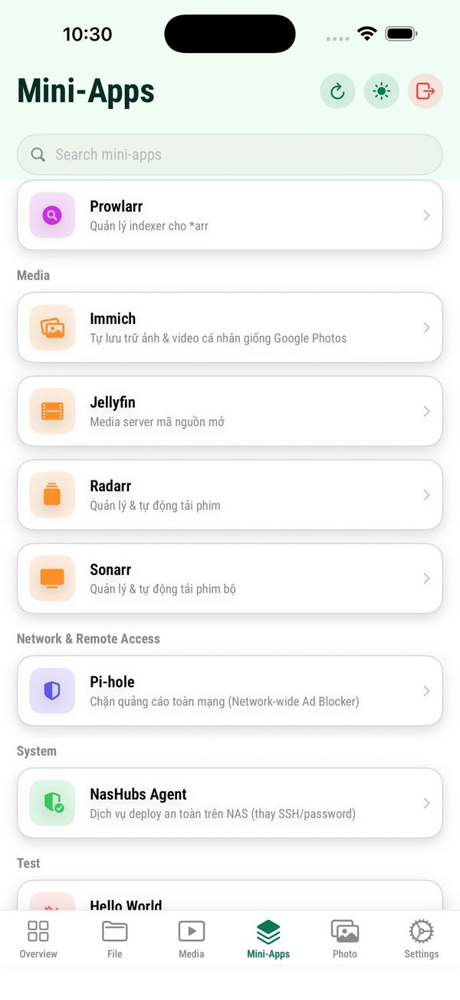
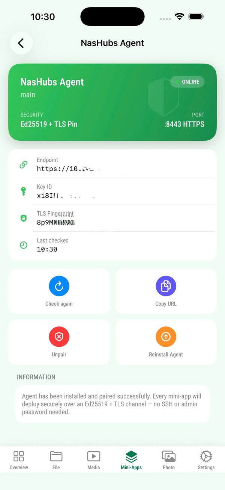

  

<h1 align="center">NasHubs</h1>

  <b>A free Synology NAS manager for Android, iPhone and iPad.</b> 
  Dashboard, files, Docker containers, users and secure remote access, with no cloud relay, no ads and no tracking.

  
  
  

  <a href="https://nashubs.duconmang.io.vn/">Website</a> ·
  <a href="https://github.com/duconmang-io/NasHubs/releases/latest">Download APK</a> ·
  <a href="https://apps.apple.com/app/nashubs/id6771762112">App Store</a> ·
  <a href="https://nashubs.duconmang.io.vn/vi/">Tiếng Việt</a>

  
  
  
  

## Why NasHubs

Managing a Synology NAS from a phone usually means switching between several apps and the DSM web UI. NasHubs puts the everyday admin work in one app, and your phone talks straight to your NAS.

## Features

| | |
|---|---|
| **Dashboard** | Live CPU, RAM, storage, temperature, running services and uptime. |
| **Files** | Browse shared folders, upload, download, rename and create share links. Open NAS files from your phone's Files app. |
| **Apps & Docker** | See, start and stop containers and packages. Install self-hosted apps such as Jellyfin, Immich and Pi-hole. |
| **Remote access** | NasHubs Agent runs on the NAS and signs every command with Ed25519 over pinned TLS. Reach it through Cloudflare Tunnel or Tailscale, with no open router ports. |
| **Admin** | Disks and storage pools, resource monitor, logs, users and groups, shared folders, USB devices. |
| **Multiple NAS** | Save several devices and switch with one tap; each one remembers its local address and its own domain. |

Features marked Pro in the app are **free too**: sign in with Google, tap *Request Pro*, and they unlock once the request is approved. There is no subscription, payment or license key.

## Download

| Platform | Get it |
|---|---|
| Android 9+ | [Latest APK from Releases](https://github.com/duconmang-io/NasHubs/releases/latest) (each release lists its SHA-256) |
| iPhone, iPad, Apple-silicon Mac | [App Store](https://apps.apple.com/app/nashubs/id6771762112) |

Requires DSM 7. Tested on a Synology DS918+; Container Manager features need a model that supports it.

## Privacy

- NAS addresses, accounts and passwords stay in the iOS Keychain or Android Keystore and are used only to connect to your NAS.
- Files, photos and admin commands go directly between your phone and your NAS; they never pass through a NasHubs server.
- A NasHubs account keeps only your e-mail, account ID and Pro request status. No ads, no analytics SDKs.

Details: [Privacy policy](https://nashubs.duconmang.io.vn/privacy/) · [Security commitments](https://nashubs.duconmang.io.vn/security/)

## FAQ

**Is NasHubs an official Synology app?**
No. It is an independent app that talks to your NAS through DSM's own web API.

**Do I need to open ports to reach my NAS remotely?**
No. Install NasHubs Agent on the NAS and connect through Cloudflare Tunnel or Tailscale.

**Why did a shared folder disappear after renaming it?**
Shared folders must be renamed in DSM → Control Panel → Shared Folder. Since 2.1.2, NasHubs blocks rename, move and delete on shared folders to prevent this.

## Feedback

Bug reports and feature requests are welcome: open an [issue](https://github.com/duconmang-io/NasHubs/issues) or e-mail **duconmang43@gmail.com** with your NAS model, DSM version and NasHubs version.

---

Synology and DSM are trademarks of Synology Inc. NasHubs is not affiliated with or endorsed by Synology Inc.

About this repository (maintainers)

This repository hosts the website at **https://nashubs.duconmang.io.vn** and the Android release files.

- Static pages live in `site/` (plain HTML/CSS, no build step). GitHub Actions (`.github/workflows/deploy.yml`) publishes to GitHub Pages on every push to `main`.
- English is the main page (`site/index.html`); Vietnamese is at `site/vi/`. Keep the hreflang tags and `site/sitemap.xml` in sync when adding pages.
- `site/privacy/` and `site/security/` are the addresses registered with the App Store; keep them unchanged.
- On a new Android release, update the download link and SHA-256 in `site/index.html` and `site/vi/index.html`.

Preview locally: `cd site && python -m http.server 8000`.

